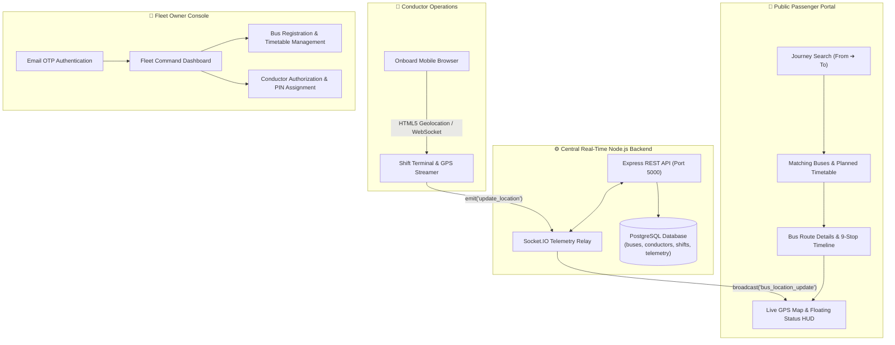

# 🚌 Karavali-Transit (ಕರಾವಳಿ ಸಾರಿಗೆ)

[](https://opensource.org/licenses/MIT)
[](https://react.dev/)
[](https://vite.dev/)
[](https://leafletjs.com/)
[](https://socket.io/)
[](https://expressjs.com/)
[](https://www.postgresql.org/)
[](https://oxc.rs/)

> **Real-Time Private Bus Tracking and Passenger Information Platform**  
> *Dedicated to the Mangaluru – Surathkal – Mulki – Udupi – Kundapura NH-66 Coastal Corridor*

---

## 📌 Overview

**Karavali-Transit** is a real-time public transit information and telemetry platform serving private bus operators, conductors, and commuters across the coastal Karnataka highway corridor (NH-66).

### 🛣️ Strict 9-Stop Corridor Alignment
The entire platform strictly serves the 9 designated corridor stations in fixed sequential order:
1. **Mangaluru** (Statebank, Hampankatta, Central)
2. **Kuntikana** (AJ Hospital & Research Centre)
3. **Kulur** (Kulur Bridge, KIADB)
4. **Surathkal** (NITK Surathkal, Junction)
5. **Mulki** (Bappanadu Temple, Bus Stand)
6. **Padubidri** (Blue Flag Beach Road, Mahaganapathi Temple)
7. **Kaup** (Lighthouse, Marigudi)
8. **Udupi** (City & Service Bus Stand, Sri Krishna Matha)
9. **Kundapura** (Shastri Circle, New Bus Stand)

---

## 🏛️ System Architecture



---

## 🚀 Key Platform Features

### 1. Passenger Portal
- **Zero Registration Required**: 100% open access for passengers without signups or accounts.
- **Single-Page Progressive Journey**:
  - `Homepage`: Searchable autocomplete boarding & destination selection with 1-click popular journeys.
  - `Bus Results`: Real-time active shift breakdown (`Active`, `All`, `Scheduled`) with planned departure/arrival times.
  - `Bus Details`: Verified vertical timeline of all 9 corridor stops with boarding (green) and destination (red) indicators.
  - `Live Tracking`: Interactive Leaflet map with NH-66 polyline, labeled stop pins, live bus marker, and floating HUD (`Next Stop`, `ETA`, `Speed`).
- **Zero Ticket Fare Policy**: No pricing, ticket fares, or booking fees are displayed anywhere on the platform.

### 2. Fleet Owner Portal
- Secure email authentication with 6-digit OTP delivery.
- KPI summary: Total fleet vehicles, active on-shift buses, authorized conductors, and scheduled trips.
- Fleet management table: Real-time status, secret conductor PINs, vehicle editing, and route schedules.
- 4-Step Bus Registration Wizard: Basic specifications, route stops, timetable schedules, and confirmation.

### 3. Conductor Terminal
- Travel agency email OTP verification and conductor mobile authorization.
- One-tap shift activation linking mobile GPS coordinates to the live bus record.
- Real-time passenger occupancy counter (`+1`, `-1`, `+5`, `-5`) with capacity badges (`Seats Available`, `Standing Allowed`, `Overcrowded`).
- Stop progression timetable and delay/incident broadcaster.

---

## 🛠️ Technology Stack

| Layer | Technology |
|---|---|
| **Frontend** | React 19, Vite 8, Tailwind CSS |
| **Maps & Telemetry** | Leaflet, React-Leaflet, Socket.IO Client |
| **Backend** | Node.js, Express 5, Socket.IO |
| **Database** | PostgreSQL (Primary) / SQLite (Fallback) |
| **Linting & Testing** | Oxlint, Node.js Native Test Runner (`node:test`) |

---

## 🏃 Running the Application

### Prerequisites
- Node.js >= 18.0.0
- PostgreSQL running locally on port 5432 with database `karavali_transit` (or SQLite fallback)

### Installation & Startup
```bash
# Install dependencies
npm install

# Start Express Backend (Port 5000)
node server.js

# Start Vite Frontend Dev Server (Port 5173)
npx vite --host
```

### Running Tests
```bash
# Run all test suites
npm test

# Run corridor integrity & passenger flow tests
node --test tests/passenger-portal-flow.test.js
node --test tests/desktop-responsiveness.test.js
```
