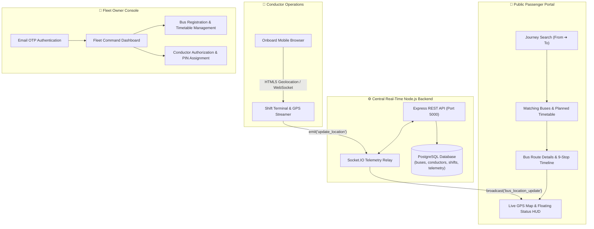
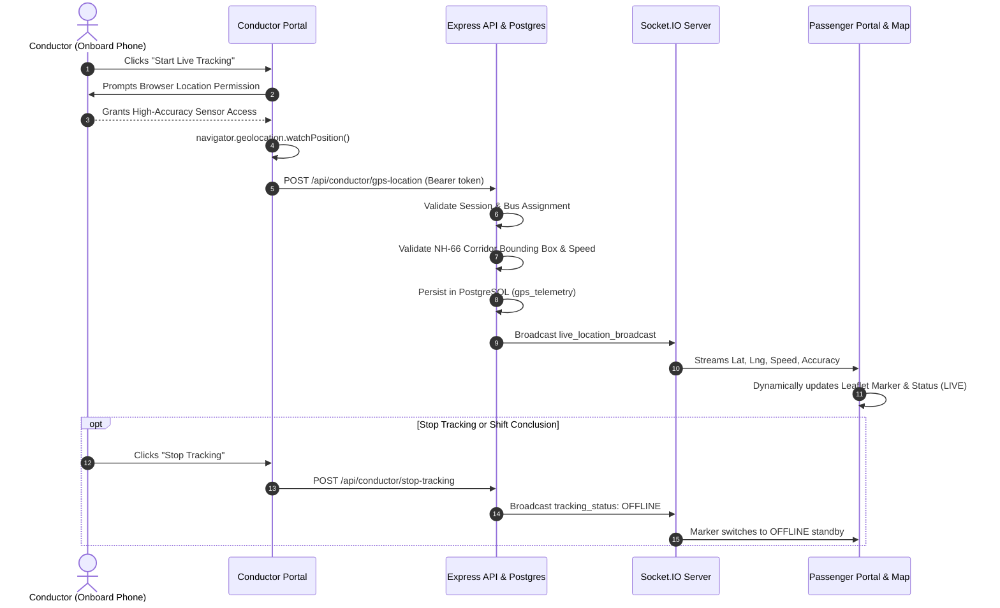

# 🚌 Karavali-Transit (ಕರಾವಳಿ ಸಾರಿಗೆ)

[](https://opensource.org/licenses/MIT)
[](https://react.dev/)
[](https://vite.dev/)
[](https://leafletjs.com/)
[](https://socket.io/)
[](https://expressjs.com/)
[](https://www.postgresql.org/)
[](https://oxc.rs/)

> **Real-Time Private Bus Tracking and Passenger Information Platform**  
> *Dedicated to the Mangaluru – Surathkal – Mulki – Udupi – Kundapura NH-66 Coastal Corridor*

---

## 📌 Overview

**Karavali-Transit** is a real-time public transit information and telemetry platform serving private bus operators, conductors, and commuters across the coastal Karnataka highway corridor (NH-66).

### 🛣️ Strict 9-Stop Corridor Alignment
The entire platform strictly serves the 9 designated corridor stations in fixed sequential order:
1. **Mangaluru** (Statebank, Hampankatta, Central)
2. **Kuntikana** (AJ Hospital & Research Centre)
3. **Kulur** (Kulur Bridge, KIADB)
4. **Surathkal** (NITK Surathkal, Junction)
5. **Mulki** (Bappanadu Temple, Bus Stand)
6. **Padubidri** (Blue Flag Beach Road, Mahaganapathi Temple)
7. **Kaup** (Lighthouse, Marigudi)
8. **Udupi** (City & Service Bus Stand, Sri Krishna Matha)
9. **Kundapura** (Shastri Circle, New Bus Stand)

---

## 🏛️ System Architecture



### 🔄 Live Telemetry Sequence Flow



---

## 🚀 Key Platform Features

### 1. Passenger Portal
- **Zero Registration Required**: 100% open access for passengers without signups or accounts.
- **Single-Page Progressive Journey**:
  - `Homepage`: Searchable autocomplete boarding & destination selection with 1-click popular journeys.
  - `Bus Results`: Real-time active shift breakdown (`Active`, `All`, `Scheduled`) with planned departure/arrival times.
  - `Bus Details`: Verified vertical timeline of all 9 corridor stops with boarding (green) and destination (red) indicators.
  - `Live Tracking`: Interactive Leaflet map with NH-66 polyline, labeled stop pins, live bus marker, and floating HUD (`Next Stop`, `ETA`, `Speed`).
- **Zero Ticket Fare Policy**: No pricing, ticket fares, or booking fees are displayed anywhere on the platform.

### 2. Fleet Owner Portal
- Secure email authentication with 6-digit OTP delivery.
- KPI summary: Total fleet vehicles, active on-shift buses, authorized conductors, and scheduled trips.
- Fleet management table: Real-time status, secret conductor PINs, vehicle editing, and route schedules.
- 4-Step Bus Registration Wizard: Basic specifications, route stops, timetable schedules, and confirmation.

### 3. Conductor Terminal
- Travel agency email OTP verification and conductor mobile authorization.
- One-tap shift activation linking mobile GPS coordinates to the live bus record.
- Real-time passenger occupancy counter (`+1`, `-1`, `+5`, `-5`) with capacity badges (`Seats Available`, `Standing Allowed`, `Overcrowded`).
- Stop progression timetable and delay/incident broadcaster.

### 4. Real-Time Smartphone GPS Hardware Telemetry
- **Actual Hardware Sensor GPS**: Uses `navigator.geolocation.watchPosition` with `{ enableHighAccuracy: true, maximumAge: 0, timeout: 15000 }` on the onboard conductor's smartphone browser.
- **Strictly No Simulation**: All simulated waypoints, random generators, and hardcoded demo GPS coordinates are completely eliminated.
- **Dynamic 4-State Tracking Lifecycle**:
  - `LIVE`: Hardware GPS active and streaming updates within the last 120 seconds.
  - `LOCATION STALE`: Shift active but no satellite ping received for > 2 minutes.
  - `NOT TRACKING`: Shift registered, waiting for conductor to click *Start Live Tracking*.
  - `OFFLINE`: Conductor stopped tracking or duty shift completed.

### 5. Security & Validation Architecture
- **Cryptographic Conductor Session Tokens**: Conductor credentials issue 12-hour cryptographic Bearer tokens upon duty check-in.
- **Server-Side Bus Assignment Enforcement**: Rejects any GPS update where the conductor is not assigned to the requested bus (HTTP 403 Forbidden).
- **Corridor Geofence Bounding Box**: Validates latitude (12.0° – 15.0° N) and longitude (73.5° – 76.0° E); rejects out-of-corridor updates (HTTP 400).
- **Speed Anomaly & Satellite Accuracy Filtering**: Rejects speeds exceeding 110 km/h and satellite accuracy fixes worse than 1000m.
- **Timestamp Freshness Verification**: Rejects expired or futuristic timestamps (> 5 mins past or > 1 min future).

---

## 🛠️ Technology Stack

| Layer | Technology |
|---|---|
| **Frontend** | React 19, Vite 8, Tailwind CSS |
| **Maps & Telemetry** | Leaflet, React-Leaflet, Socket.IO Client |
| **Backend** | Node.js, Express 5, Socket.IO |
| **Database** | PostgreSQL (Primary) / SQLite (Fallback) |
| **Linting & Testing** | Oxlint, Node.js Native Test Runner (`node:test`) |

---

## 📡 REST API Reference

### Real-Time GPS & Conductor Operations
| Method | Endpoint | Access | Description |
|---|---|---|---|
| `POST` | `/api/conductor/lookup` | Public | Verify travel agency conductor mobile status and retrieve assigned buses. |
| `POST` | `/api/conductor/register` | Public | Fast crew registration under travel agency and token generation. |
| `POST` | `/api/conductor/start-duty` | Conductor | Initialize active shift, link assigned bus, and issue session Bearer token. |
| `POST` | `/api/conductor/gps-location` | Authenticated | Ingest real-time smartphone GPS coordinates (`lat`, `lng`, `accuracy`, `speed`, `heading`). |
| `POST` | `/api/conductor/stop-tracking` | Authenticated | Pause GPS streaming and mark bus `OFFLINE`. |

### Public Passenger Information
| Method | Endpoint | Description |
|---|---|---|
| `GET` | `/api/public/stops/search?q=` | Search 9 corridor stops by English, Kannada, or nearby landmarks. |
| `GET` | `/api/public/buses/search?from=&to=` | Journey search matching forward order across the 9 official corridor stops. |
| `GET` | `/api/public/buses/:id` | Retrieve public bus timetable and live status without pricing/fare data. |
| `GET` | `/api/public/buses/:id/route` | Complete 9-stop corridor timeline and planned stop arrivals. |
| `GET` | `/api/public/buses/:id/location` | Current tracking status (`LIVE`, `LOCATION STALE`, `NOT TRACKING`, `OFFLINE`) and GPS coordinates. |
| `POST` | `/api/public/feedback` | Submit passenger feedback and ratings. |

---

## 🏃 Running the Application

### Prerequisites
- Node.js >= 18.0.0
- PostgreSQL running locally on port 5432 with database `karavali_transit` (or SQLite fallback)

### Installation & Startup
```bash
# Install dependencies
npm install

# Start Express Backend (Port 5000)
node server.js

# Start Vite Frontend Dev Server (Port 5173)
npx vite --host
```

### Running Tests
```bash
# Run all test suites
npm test

# Run real-time GPS tracking & conductor security suite
node --test tests/conductor-gps-tracking.test.js

# Run corridor integrity & passenger flow tests
node --test tests/passenger-portal-flow.test.js
node --test tests/desktop-responsiveness.test.js

# Code quality and zero-warning lint check
npx oxlint

# Production build verification
npm run build
```

### Automated GPS Verification Checklist
- [x] Conductor Bearer token issuance during shift initialization
- [x] Rejection of unauthenticated GPS updates (HTTP 401)
- [x] Rejection of bus assignment mismatches (HTTP 403)
- [x] Coastal Karnataka corridor boundary enforcement (HTTP 400)
- [x] Impossible bus speed spike rejection (> 110 km/h)
- [x] Sensor GPS ingestion and PostgreSQL `gps_telemetry` persistence
- [x] Real-time Leaflet bus marker updating via Socket.IO
- [x] Stop tracking transition to `OFFLINE` status
- [x] Automatic stale location detection (> 120s inactivity)

---

## ♿ Passenger Portal Usability & Accessibility Standards

The Karavali-Transit frontend adheres to public transportation design principles emphasizing simplicity, legibility, and usability:

- **Legibility & Contrast**: High-contrast slate color palette (`text-slate-900`, `text-slate-800`, `text-slate-700`) exceeding WCAG AA minimum contrast ratio (4.5:1).
- **Zero Login Barrier**: No passenger login, signups, or authentication required. A clear notice (`✓ No passenger login required`) is visible directly above the journey search form.
- **Bilingual Localization**: Seamless language switching between English and Kannada (ಕನ್ನಡ) across all headings, navigation items, stop names, and status alerts.
- **Fixed NH-66 Corridor Alignment**: Strictly limited to the 9 official stations in immutable order without fictitious stops, ticket booking, or fares.

### ⌨️ Keyboard Accessibility & Touch Targets
| Element | Touch Target / Shortcut | Standard |
|---|---|---|
| Stop Dropdown Combobox | `min-h-[48px]` | `role="combobox"`, `aria-expanded`, `Enter`/`Space` to open |
| Dropdown List Options | `min-h-[44px]` | `role="listbox"`, `ArrowDown`/`ArrowUp` navigation, `Enter` to select, `Escape` to dismiss |
| Stop Swap Button | `44x44px` | Bidirectional stop swapping maintaining valid forward corridor sequence |
| Find Available Buses Button | `min-h-[48px]` | Primary action button with high-contrast text and active state feedback |
| Popular Journey Chips | `min-h-[42px]` | 1-tap journey search shortcuts for rapid commuter access |

---

## 📡 Live Tracking HUD Status Engine

The floating HUD card provides deterministic transparency on bus progress along the NH-66 corridor:

```
+----------------------------------------------------------------+
|  Vishal Express (KA-19-F-3210)                    [ LIVE GPS ]  |
+-------------------------------+--------------------------------+
|  Destination: Udupi           |  Telemetry Speed: 48 km/h      |
+-------------------------------+--------------------------------+
|  Crew: Suresh Poojary         |  Planned Departure: 10:40 AM   |
+-------------------------------+--------------------------------+
|  * Last updated: 10:42:15 AM (4s ago)                          |
+----------------------------------------------------------------+
```

### Telemetry Lifecycle States
- **`LIVE GPS`** (Green): Active hardware GPS coordinates received within the last 120 seconds. Real sensor speed displayed.
- **`LOCATION STALE`** (Amber): Shift is active but no satellite ping received for > 2 minutes. Alert shown to passenger.
- **`NOT TRACKING`** (Blue): Bus is scheduled/on shift, but conductor has not started mobile GPS broadcasting. Timetable schedule is displayed.
- **`OFFLINE`** (Slate): Service is currently off duty or finished shift. Verified timetable planned arrival is presented without simulated data.

---

## 🧭 Corridor Journey Matching & Empty State Mechanics

### Sequential Corridor Ordering
Bus search requires forward direction along the coastal alignment:
$$\text{StopOrder}(\text{Boarding}) < \text{StopOrder}(\text{Destination})$$

1. **Forward Searches** (e.g. `Surathkal` [#4] ➔ `Udupi` [#8]): Matched against verified timetable records where both stops are present in order.
2. **Reverse Searches** (e.g. `Kundapura` [#9] ➔ `Mangaluru` [#1]): Southbound alignment is handled cleanly by stopping inverted searches and directing passengers to forward trips.
3. **Empty States**: If zero active or scheduled buses operate for a specific stop pair under an active filter (`Active`, `All`, `Scheduled`), a helpful card displays guidance with a single-click modification button to return to the search view.

---

## ✅ Frontend Quality Assurance & Verification Standards

All frontend improvements pass the following verification checks:

- [x] **0 Oxlint Warnings & Errors**: 100% clean linter execution across all React JSX and JS modules.
- [x] **Zero Ticket Pricing**: Strict policy against fares, price labels, or fees in UI and API payloads.
- [x] **Zero Fake Coordinates**: Leaflet markers render strictly from real hardware telemetry.
- [x] **Mobile Responsiveness**: Verified across mobile (375px), tablet (768px), and desktop (1280px+).
- [x] **Corridor Preservation**: Exactly 9 official stops maintained sequentially.
- [x] **Portal Separation**: Owner and Conductor portals remain completely intact.

---

## 🧑‍✈️ Conductor Authentication & Onboarding Lifecycle

The Conductor authentication workflow is engineered for simplicity, security, and immediate field readiness on drivers' and conductors' mobile devices:

```
[ Step 1: Sign In ] ──── OTP ────► [ Step 2: Verify ] ──── Mobile ────► [ Step 3: Bus Shift ]
  Travel Agency Email               6-Digit OTP Box                       Live Sensor GPS
```

### 1. Step 1: Conductor Sign In Card
- **Professional Brand Icon**: Features a high-contrast transit bus icon replacing generic symbols.
- **Agency Email Validation**: Accepts the registered agency owner's Gmail address (`Enter registered Gmail address`).
- **Owner Scope**: Ensures crew operates strictly under an authorized fleet agency.
- **Verification Trigger**: Generates a cryptographically random 6-digit OTP code delivered directly to the fleet agency inbox.
- **Direct Link**: Seamlessly allows conductors to return to the public Passenger Radar anytime.

### 2. Step 2: 6-Digit OTP Verification Screen
- **Individual Input Cells**: Six discrete digit boxes with automatic forward focus progression and backspace handling.
- **Native Clipboard Support**: Instant auto-fill of all 6 digits when copied from an email client or SMS relay.
- **Rate-Limited Resend**: A 25-second countdown timer prevents OTP spamming and enforces network stability.
- **Agency Token Issuance**: Successful verification unlocks an authenticated 12-hour session bearer token for duty operations.
