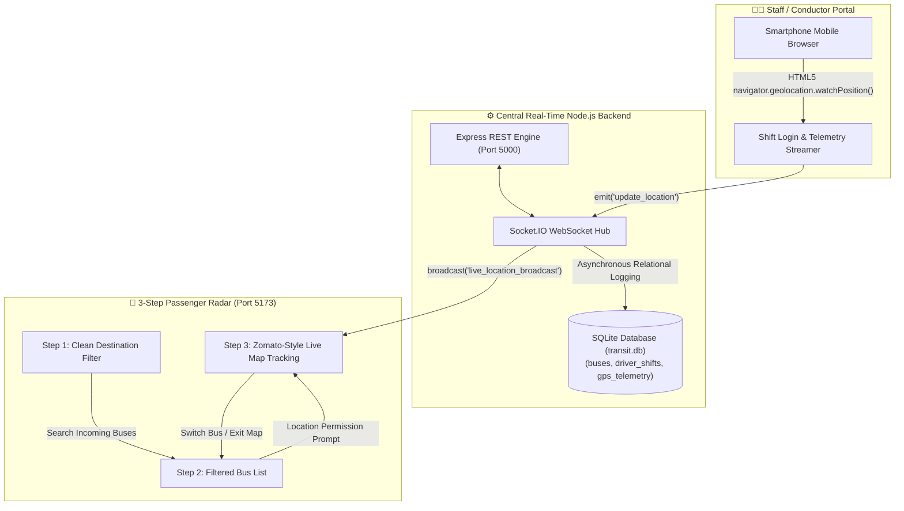
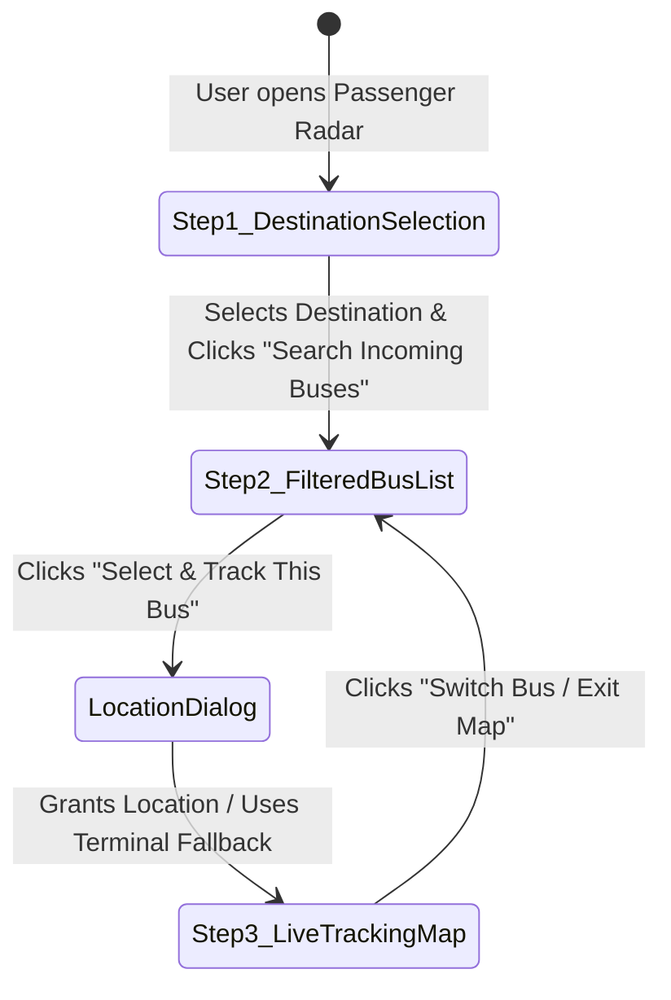

# 🚌 Karavali Sarige (ಕರಾವಳಿ ಸಾರಿಗೆ) • Karavali-Transit

[](https://opensource.org/licenses/MIT)
[](https://react.dev/)
[](https://vite.dev/)
[](https://leafletjs.com/)
[](https://socket.io/)
[](https://expressjs.com/)
[](https://www.sqlite.org/)
[](https://oxc.rs/)

> **Official Coastal Karnataka Real-Time Public Bus Tracking & Telemetry System**  
> *Hardware-Free GPS Telemetry • Zomato-Style Live Navigation Line • Staged 3-Step Passenger Journey • Relational SQL Persistence*

---

## 📌 Executive Overview

**Karavali-Transit** is a hardware-free smart transit intelligence platform engineered specifically for the coastal corridor of Karnataka (connecting Mangaluru Statebank, Hampankatta, Lalbagh, Nanthoor, Kuloor, and Surathkal / NITK along the high-density NH-66 highway).

### 💡 Why Hardware-Free?
Traditional public transit vehicle tracking depends on expensive, proprietary IoT GPS boxes wired into bus batteries. **Karavali-Transit eliminates 100% of these hardware costs**:
1. **Conductors & Drivers** open the responsive web app on any Android or iOS smartphone and tap **"Start Shift & Stream GPS"**. Native HTML5 Geolocation (`watchPosition`) streams sub-second coordinates over low-latency WebSockets.
2. **Passengers** experience a staged, clutter-free 3-step booking & tracking funnel: from destination selection to a filtered bus list, into a **Zomato-style live delivery tracking map** featuring an animated royal blue route line directly connecting the commuter to the incoming bus.
3. **Transport Authorities** maintain centralized, relational SQL logging in [`transit.db`](file:///c:/Users/gowda/karavali-transit/transit.db) tracking driver shifts, vehicle velocities, and congestion bottlenecks.

---

## 🏛️ System Architecture



---

## 🗺️ Staged 3-Step Passenger Journey



### 1️⃣ Step 1: Destination/Route Selection Screen (Default Landing)
- **Zero-Clutter Landing**: No map tiles or large bus lists are loaded initially, preventing cognitive overload for everyday commuters.
- **Boarding Stop Display**: Clearly displays the passenger's current boarding terminal (*Mangaluru Statebank Central Terminal*).
- **1-Tap Quick Destination Filter Pills**:
  - `Surathkal / NITK` (10.5 km Coastal Corridor)
  - `Udupi` (Coastal Express Artery)
  - `Kuloor` (City Ordinary Corridor)
  - `Statebank` (Central Inbound Terminal)
  - `All Routes` (Full Fleet Overview)
- **Search & Service Toggles**: Free-text search for route numbers (e.g. `15`) or bus names (e.g. `Vishal Express`), with filters for `All`, `⚡ Express`, or `🚌 Ordinary`.
- **Primary CTA**: Large high-contrast button: **"Search Incoming Buses ➔"**.

---

### 2️⃣ Step 2: Filtered Bus List Screen
- **Targeted Corridor Display**: Shows only the active buses operating along the chosen destination corridor.
- **Header Navigation**: Features a **"← Change Destination"** button to jump back to Step 1 without page reloads.
- **Comprehensive Bus Cards**:
  - Route Tag & Vehicle Number (e.g., `Route #15 • KA-19-AB-4509`).
  - Classification: `⚡ Express Service` (limited stops) vs `🚌 City / Ordinary` (all stops).
  - Dynamic Stop Arrival Countdown (e.g., **`3 MINS`**), scheduled clock time (e.g., `1:15 PM`), and current velocity (`38 km/h`).
  - Smart Delay Predictor: Dynamically identifies congestion bottlenecks (`✅ On Time` vs. `⚠️ +4m Late`).
  - Crowd Load Indicators: `🟢 Seats Available`, `🟡 Standing Room`, `🔴 Full Capacity`.
  - Night Safety Badge: `🌙 LAST BUS OF THE NIGHT` alert for late services.
- **Action**: One-click **"Select & Track This Bus ➔"** initiates the location confirmation.

---

### 3️⃣ Step 3: Zomato-Style Live Tracking Map View
- **Location Permission Dialog**: Prompts *"Turn on your location to track this bus live"* before map activation, supporting native HTML5 GPS or terminal boarding stop fallback.
- **Single-Bus Isolation**: All other fleet buses are hidden from the map view, focusing 100% on the commuter's incoming bus (identical to food delivery apps tracking your delivery partner).
- **Passenger Pin (`🧍‍♂️ You`)**: High-contrast marker with an animated green radar wave ring showing the passenger's boarding location.
- **Animated Royal Blue Route Polyline**: Royal blue navigation line (`#1d4ed8`) with moving dashes directly connecting the passenger pin to the approaching bus.
- **Floating Telemetry HUD**: Displays real-time road distance (e.g. `2.4 km away from your stop`), stop arrival countdown, and vehicle speed.
- **"← Switch Bus / Exit Map" Button**: Pinned navigation button that returns the commuter back to Step 2 to select another bus instantly without page reloading.

---

## 👨‍✈️ Driver & Conductor Duty Portal

- **Hardware-Free GPS Streaming**: Built on native browser HTML5 Geolocation (`navigator.geolocation.watchPosition`).
- **Corridor Simulation Fallback**: Automatically activates a smooth, realistic 6-waypoint simulation along NH-66 for desktop/laptop evaluation.
- **1-Click Duty Presets**: Instant prefilled profiles for quick demonstrations:
  - `⚡ Vishal Express (Route 15: Mangaluru Statebank ➔ Surathkal)`
  - `⚡ Canara Pinto Deluxe (Route NH-66: Mangaluru Statebank ➔ Udupi)`
  - `🚌 Padmambika Local (Route 21: Mangaluru Statebank ➔ Kuloor)`
  - `🚌 Coastal Star City (Route 15B: Surathkal ➔ Mangaluru Statebank)`
- **Safety Toggles**: Conductor can mark the bus as the **"Night Last Bus"** and update crowd occupancy in real time.
- **Live Duty Dashboard**: Confirms active streaming, vehicle registration, and SQLite database logging.

---

## 🗄️ Relational SQL Schema & Database Architecture

Powered by SQLite ([`transit.db`](file:///c:/Users/gowda/karavali-transit/transit.db)) with complete PostgreSQL readiness ([`db.js`](file:///c:/Users/gowda/karavali-transit/db.js)).

### Tables:
1. **`buses`**:
   - `bus_id`: Primary Key (Auto-increment)
   - `bus_name`: Operator/Brand name (e.g., `Vishal Express`)
   - `vehicle_number`: Unique registration string (`KA-19-AB-4509`)
   - `route_number`: Highway corridor number (`15`, `NH-66`, `21`)
   - `service_type`: `Express` or `City / Ordinary`
   - `origin` & `destination`: Terminal endpoints
   - `is_last_bus`: Night safety flag (0 or 1)
2. **`driver_shifts`**:
   - `shift_id`: Primary Key
   - `driver_phone`, `vehicle_number`, `bus_name`, `route_name`
   - `start_time`, `end_time`, `status`: Active shift logging
3. **`gps_telemetry`**:
   - `log_id`: Primary Key
   - `bus_id`, `latitude`, `longitude`, `speed`, `delay_minutes`
   - `recorded_at`: Telemetry timestamp

### REST API Endpoints:
| Method | Endpoint | Description |
| :--- | :--- | :--- |
| `GET` | `/api/health` | Returns server operational status and database connection state |
| `GET` | `/api/buses` | Retrieves all registered coastal express and ordinary buses |
| `GET` | `/api/shifts` | Lists active and historical conductor operational duty records |
| `GET` | `/api/telemetry` | Retrieves recent GPS coordinates and speed telemetry logs |

---

## 🛠️ Technology Stack

| Domain | Technology | Description |
| :--- | :--- | :--- |
| **Frontend Framework** | [React 19](https://react.dev/) + [Vite](https://vite.dev/) | Modern reactive architecture with sub-second HMR |
| **Mapping Engine** | [Leaflet](https://leafletjs.com/) + [React-Leaflet](https://react-leaflet.js.org/) | Hardware-accelerated map rendering with OpenStreetMap tiles |
| **Styling & UI** | Tailwind CSS + Official Custom CSS | Official Karnataka State Transit (`Karavali Sarige`) light mode |
| **Iconography** | [Lucide React](https://lucide.dev/) | Clean, accessible vector icons |
| **Real-Time WebSockets** | [Socket.IO](https://socket.io/) (Server + Client) | Sub-second bidirectional GPS telemetry broadcasting |
| **Backend Framework** | [Node.js](https://nodejs.org/) + [Express](https://expressjs.com/) | RESTful API server and static asset handling |
| **Database** | SQLite3 ([`transit.db`](file:///c:/Users/gowda/karavali-transit/transit.db)) + `pg` | Relational storage for fleet, shifts, and telemetry logs |
| **Code Quality** | [Oxlint](https://oxc.rs/) | 0 warnings, 0 errors high-speed JavaScript/JSX linter |

---

## 🚀 Getting Started

### Prerequisites
- [Node.js](https://nodejs.org/) (v18.0 or newer)
- `npm` (bundled with Node.js)

### 1. Clone & Install
```bash
git clone https://github.com/sanath-labs/Karavali-Transit.git
cd Karavali-Transit
npm install
```

### 2. Start the Backend Server (Terminal 1)
```bash
npm run server
# Central fleet telemetry engine starts on http://localhost:5000
# SQLite database connected: transit.db
```

### 3. Start the Frontend Application (Terminal 2)
```bash
npm run dev
# Vite client starts on http://localhost:5173
```

### 4. Run Automated Tests & Quality Checks
```bash
npm test        # Runs database smoke tests and passenger journey suite
npm run lint    # Runs Oxlint inspection (0 warnings, 0 errors)
npm run build   # Verifies production Vite bundle build
```

---

## 🧪 60-Second Live Demonstration Guide

To experience real-time synchronization between Conductor and Passenger:

1. **Tab 1 — Passenger Radar**:
   - Open [`http://localhost:5173`](http://localhost:5173) in your browser.
   - **Step 1**: Click **"Surathkal / NITK"** and click **"Search Incoming Buses ➔"**.
   - **Step 2**: Review the filtered bus list (notice *Vishal Express*).
   - **Step 3**: Click **"Select & Track This Bus"** and click **"Turn On Location & Track Bus"**.
   - You now see the live Leaflet map with your pin (`🧍‍♂️`), the bus (`🚍`), and the animated blue route line!

2. **Tab 2 — Conductor Portal**:
   - Open a second browser tab at [`http://localhost:5173`](http://localhost:5173).
   - Switch the top header to **Staff / Conductor Portal**.
   - Click the preset **⚡ Vishal Express (#15)** and click **"Start Shift & Stream GPS"**.

3. **Observe Tab 1**:
   - Watch the bus marker on the map in Tab 1 move smoothly along NH-66 in real time!
   - Notice the floating HUD update the distance (`2.4 km away from your stop`) and ETA countdown automatically.
   - Click **"← Switch Bus / Exit Map"** anytime to return to Step 2 and track another vehicle!

---

## 📚 Architectural & Technical Documentation

- [`docs/PASSENGER_JOURNEY.md`](file:///c:/Users/gowda/karavali-transit/docs/PASSENGER_JOURNEY.md): Complete state machine specification for the 3-step passenger journey.
- [`docs/API.md`](file:///c:/Users/gowda/karavali-transit/docs/API.md): Full REST endpoint specifications and Socket.IO event payloads.
- [`docs/CORRIDORS.md`](file:///c:/Users/gowda/karavali-transit/docs/CORRIDORS.md): NH-66 coastal highway waypoint GPS coordinates and delay prediction formulas.
- [`CONTRIBUTING.md`](file:///c:/Users/gowda/karavali-transit/CONTRIBUTING.md): Developer contributing guidelines and Git commit conventions.

---

## 📄 License

This project is licensed under the [MIT License](LICENSE) — free for public transit authorities, academic institutions, and developer portfolios.
