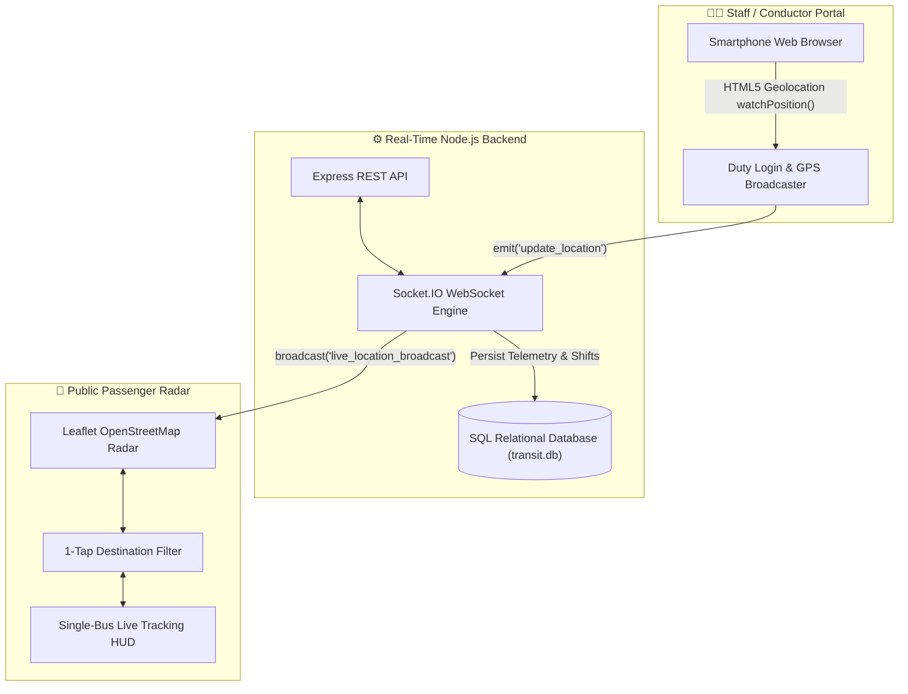

# 🚌 Karavali Sarige (ಕರಾವಳಿ ಸಾರಿಗೆ) • Karavali-Transit

> **Official Coastal Karnataka Real-Time Public Bus Tracking & Telemetry System**  
> *Hardware-Free GPS Broadcasting • High-Performance WebSockets • Interactive Leaflet Radar • Relational SQL Persistence*

---

## 📌 Overview

**Karavali-Transit** is a full-stack, hardware-free real-time transit intelligence platform engineered for the coastal corridor of Karnataka (connecting Mangaluru Statebank, Hampankatta, Lalbagh, Nanthoor, Kuloor, and Surathkal along NH-66).

Traditional transit tracking systems require expensive, proprietary IoT GPS hardware installed in every bus. **Karavali-Transit eliminates all hardware requirements**:
1. **Conductors/Drivers** simply log in on their smartphone browser to start duty and stream real-time GPS coordinates directly via WebSockets.
2. **Passengers** instantly observe buses approaching on an interactive, high-contrast Leaflet radar map with dynamic arrival countdowns (e.g., `3 MINS`), scheduled clock times, service categorization (`⚡ Express` vs. `🚌 Ordinary`), crowd capacity, and delay predictions.
3. **Transit Authorities** gain centralized relational SQL logging of all driver shifts, vehicle telemetry, and route analytics.

---

## 🏛️ System Architecture



---

## ✨ Key Features & Capabilities

### 1. 🧍 3-Step Passenger Journey & Live Radar
* **Step 1 — Clean Destination Selection (Landing):** When opening the app, commuters see ONLY an uncluttered destination selection interface with no map or bus list distraction. Quick 1-tap destination pills (`Surathkal / NITK`, `Udupi`, `Kuloor`, `Statebank`, `All Routes`), route search, and a primary *"Search Incoming Buses ➔"* action.
* **Step 2 — Filtered Bus List Screen:** Displays only the buses operating along the commuter's selected destination corridor. Highlights route numbers, `⚡ Express` vs. `🚌 Ordinary` classifications, crowd load, next arrival countdown (`3 MINS`), scheduled time, and `🌙 LAST BUS OF THE NIGHT` alerts.
* **Step 3 — Zomato-Style Live Tracking Map:**
  * **Location Permission Prompt:** When selecting a bus, prompts *"Turn on your location to track this bus live"*, supporting native HTML5 GPS or terminal boarding stop fallback.
  * **Single-Bus Isolation:** Automatically focuses on ONLY the tracked bus (filtering out other buses for zero distraction, just like tracking a delivery partner in Zomato).
  * **Animated Blue Navigation Route Line:** Draws a royal blue glowing navigation polyline with moving dashes directly connecting the passenger pin (`🧍‍♂️ You`) and the incoming bus (`🚍`).
  * **Live Distance & Arrival HUD:** Displays real-time road distance (e.g. `2.4 km away from your stop`), arrival countdown, speed, and congestion delays.
  * **Switch Bus / Exit Map Button:** Pinned top navigation button to return to Step 2 instantly without page reloading.

### 2. 👨‍✈️ Driver & Conductor Duty Portal
* **Hardware-Free GPS Telemetry:** Uses native browser HTML5 Geolocation (`watchPosition`) with automated coastal corridor simulation fallback for desktop testing.
* **1-Click Duty Presets:** Instant prefilled profiles for quick demonstrations:
  * `⚡ Vishal Express (Route 15: Statebank ➔ Surathkal)`
  * `⚡ Canara Pinto Deluxe (Route NH-66: Statebank ➔ Udupi)`
  * `🚌 Padmambika Local (Route 21: Statebank ➔ Kuloor)`
  * `🚌 Coastal Star City (Route 15B: Surathkal ➔ Statebank)`
* **Night Last Bus Flag:** Conductors can flag a bus as the last night service to alert commuters.
* **Live Shift Telemetry:** Displays driver contact, vehicle registration number, active route corridor, and real-time streaming confirmation.

### 3. 🗄️ Relational SQL Database & REST API
* Powered by SQLite (`transit.db`) with complete PostgreSQL compatibility.
* **Schema Tables:**
  * `buses`: Registered vehicles, route numbers, service types, and destinations.
  * `driver_shifts`: Active and historical duty shifts with driver phone numbers and timestamps.
  * `gps_telemetry`: High-frequency coordinates, speeds, and delay records.
* **REST Endpoints:**
  * `GET /api/health`: System health and SQL connection status.
  * `GET /api/buses`: Complete fleet directory from the database.
  * `GET /api/shifts`: Conductor shift logs.
  * `GET /api/telemetry`: Recent GPS telemetry records.

---

## 🛠️ Technology Stack

| Layer | Technology | Purpose |
| :--- | :--- | :--- |
| **Frontend Framework** | React 19 + Vite | High-performance SPA with instant Hot Module Replacement (HMR) |
| **Mapping & Geospatial** | Leaflet + React-Leaflet | Hardware-accelerated map rendering with OpenStreetMap tiles |
| **Styling & UI** | Custom CSS3 | Clean official public transport light theme, high-contrast typography |
| **Icons** | Lucide React | Lightweight, accessible iconography |
| **Real-Time WebSockets** | Socket.IO + Socket.IO Client | Bidirectional low-latency GPS streaming between buses and passengers |
| **Backend Runtime** | Node.js + Express | RESTful API server and static asset handling |
| **Database** | SQLite3 (`transit.db`) + PostgreSQL support | Relational storage for fleet registry, duty shifts, and telemetry logs |

---

## 🚀 Quick Start Guide

### Prerequisites
* [Node.js](https://nodejs.org/) (v18 or higher recommended)
* `npm` (bundled with Node.js)

### 1. Clone the Repository
```bash
git clone https://github.com/sanath-labs/Karavali-Transit.git
cd Karavali-Transit
```

### 2. Install Dependencies
```bash
npm install
```

### 3. Start the Backend Server
```bash
npm run server
# Backend server runs on http://localhost:5000 with SQL database (transit.db)
```

### 4. Start the Frontend Application
In a separate terminal window:
```bash
npm run dev
# Frontend runs on http://localhost:5173
```

---

## 🧪 Dual-Tab Live Test Walkthrough

To experience the real-time synchronization in action:
1. Open **Tab 1** at `http://localhost:5173` (**Passenger Radar**).
2. Open **Tab 2** (or an Incognito window) at `http://localhost:5173` and switch to **Staff / Driver Portal**.
3. In Tab 2, tap any quick preset (e.g. `⚡ Canara Pinto (#NH-66)`) and click **"Start Duty & Stream Live GPS"**.
4. Switch back to Tab 1:
   * Notice the bus appear in the list with its **`⚡ Express`** badge and live arrival time.
   * Click on the bus: The card illuminates in blue, and the Leaflet camera smoothly tracks the bus along the NH-66 corridor.

---

## 📄 License

This project is licensed under the MIT License — feel free to use and adapt for academic, research, or public transit initiatives.
