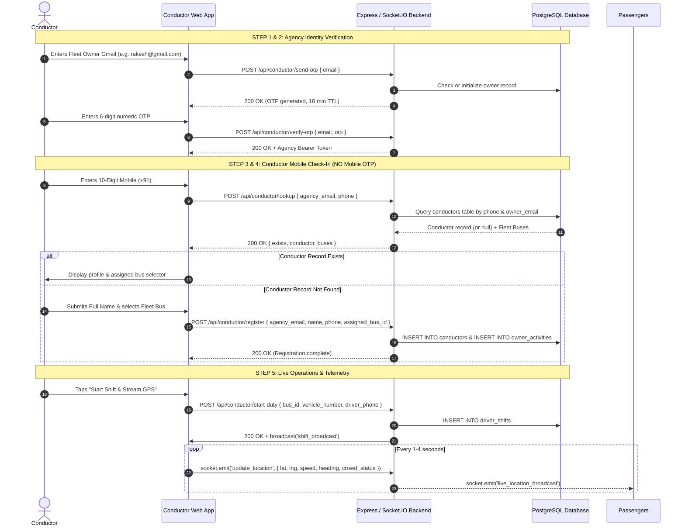

# 👨‍✈️ Conductor Portal Technical Specification

## 1. Overview & Authentication Lifecycle

The **Karavali-Transit Conductor Portal** provides a resilient, mobile-optimized duty management interface for certified bus conductors and drivers.

### Complete 5-Step Workflow



---

## 2. PostgreSQL Relational Models

### Conductors Table (`conductors`)
```sql
CREATE TABLE IF NOT EXISTS conductors (
  conductor_id SERIAL PRIMARY KEY,
  owner_email VARCHAR(255) NOT NULL,
  name VARCHAR(255) NOT NULL,
  phone VARCHAR(50) NOT NULL,
  assigned_bus_id INTEGER,
  status VARCHAR(50) DEFAULT 'Active',
  created_at TIMESTAMP DEFAULT CURRENT_TIMESTAMP,
  FOREIGN KEY (assigned_bus_id) REFERENCES buses(bus_id) ON DELETE SET NULL
);
```

### Driver Shifts Table (`driver_shifts`)
```sql
CREATE TABLE IF NOT EXISTS driver_shifts (
  shift_id SERIAL PRIMARY KEY,
  driver_phone VARCHAR(50),
  vehicle_number VARCHAR(50),
  bus_name VARCHAR(255),
  route_name VARCHAR(255),
  start_time TIMESTAMP DEFAULT CURRENT_TIMESTAMP,
  end_time TIMESTAMP
);
```

---

## 3. Real-Time Socket.IO Protocol Contracts

### Telemetry Update (`update_location`)
```json
{
  "bus_id": 1,
  "vehicle_number": "KA-19-AB-4509",
  "lat": 12.8718,
  "lng": 74.8430,
  "speed": 42,
  "heading": 350,
  "crowd_status": "Seats Available",
  "passenger_count": 18,
  "timestamp": 1793506800000
}
```

### Emergency & Delay Alert (`send_alert`)
```json
{
  "type": "traffic",
  "message": "Vishal Express (KA-19-AB-4509): Moderate traffic congestion near Surathkal junction (+15 min delay)",
  "bus_id": 1,
  "timestamp": 1793506800000
}
```

---

## 4. Frontend Component Design

- **State machine**: 5 sequential steps with persistent local caching and graceful fallback.
- **Hardware-Free GPS**: Uses browser `navigator.geolocation.watchPosition` with automatic fallback to Coastal NH-66 corridor trajectory waypoints on desktops or low-accuracy environments.
- **Occupancy Monitor**: Real-time counter with 3-tier occupancy classification:
  - `Seats Available`: Occupancy under 75% capacity.
  - `Standing Allowed`: Occupancy between 75% and 100% capacity.
  - `Overcrowded`: Occupancy exceeding 100% seated capacity.
- **Waybill Printing**: Formatted printer-friendly CSS stylesheet (`@media print`) generating official coastal transit trip receipts.
